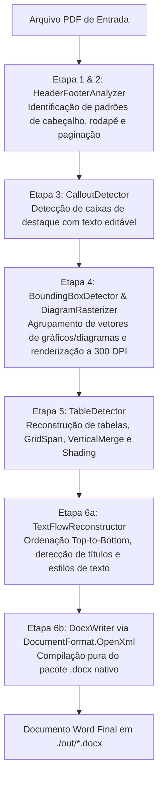

# 📄 pdf2word — Conversor de PDF para Word (.docx) de Alta Fidelidade

[](https://dotnet.microsoft.com/)
[](LICENSE)
[](#pré-requisitos)

O **pdf2word** é uma aplicação de linha de comando (CLI) de alta performance, 100% gratuita e de código aberto, desenvolvida em **C# / .NET 8** para conversão inteligente e de alta fidelidade de documentos PDF técnicos, corporativos e relatórios complexos em arquivos Word editáveis (`.docx`).

Diferente de conversores convencionais que apenas despejam caixas de texto flutuantes ou rasterizam páginas inteiras perdendo a editabilidade, o **pdf2word** implementa um **pipeline analítico geométrico de 6 etapas**, capaz de reconstruir o fluxo textual real, tabelas nativas com células mescladas, caixas de destaque (*callouts*) e isolar diagramas e ilustrações em alta resolução (300+ DPI).

---

## 📑 Sumário

- [Destaques e Funcionalidades](#-destaques-e-funcionalidades)
- [Pipeline de Conversão (6 Etapas)](#-pipeline-de-conversão-6-etapas)
- [Tecnologias e Bibliotecas](#-tecnologias-e-bibliotecas)
- [Estrutura do Projeto](#-estrutura-do-projeto)
- [Pré-requisitos](#-pré-requisitos)
- [Instalação e Download](#-instalação-e-download)
- [Como Buildar](#-como-buildar)
- [Como Rodar](#-como-rodar)
  - [1. Modo Interativo com Drag-and-Drop (Recomendado)](#1-modo-interativo-com-drag-and-drop-recomendado)
  - [2. Comando `convert` (Arquivo Único via Argumentos)](#2-comando-convert-arquivo-único-via-argumentos)
  - [3. Comando `batch` (Pasta / Lote)](#3-comando-batch-pasta--lote)
- [Suporte a OCR (Páginas Escaneadas)](#-suporte-a-ocr-páginas-escaneadas)
- [Licença](#-licença)

---

## ✨ Destaques e Funcionalidades

- **Execução Simplificada (`dotnet run`) com Melhores Parâmetros Automáticos**: Ao rodar sem argumentos, aplica automaticamente a configuração de máxima fidelidade (`300 DPI`, `OCR Fallback = Ativo`, `Verbose = Ativo`) e salva na pasta `./out/`.
- **Suporte a *Drag-and-Drop* no Terminal**: Basta arrastar e soltar o arquivo PDF na janela do terminal após rodar `dotnet run` (tratamento automático de aspas, espaços, caracteres acentuados e prefixo `&` do PowerShell).
- **Pasta de Saída `./out` Não Versionada**: Todos os documentos `.docx` gerados são salvos automaticamente na pasta `./out` na raiz do projeto, já configurada no `.gitignore`.
- **Reconstrução Semântica do Texto**: Identifica títulos (`H1`, `H2`, `H3`), subtítulos, parágrafos normais, listas com marcadores vetoriais (`•`) e listas numeradas.
- **Detecção Ortogonal de Tabelas**: Reconhece grades de tabelas com suporte a mesclagem horizontal (`GridSpan`), vertical (`VerticalMerge`), cores de preenchimento de célula (*shading*) e alinhamento do conteúdo.
- **Isolamento de Diagramas Vetoriais (Bounding Box)**:
  - Agrupa primitivas vetoriais complexas (setas, fluxogramas, gráficos, curvas) via algoritmo *Union-Find*.
  - Absorve textos internos/rótulos dentro do diagrama para evitar duplicação textual no corpo do documento.
  - Rasteriza e recorta a área exata via **Google PDFium** em **300+ DPI** sem perdas de qualidade.
- **Caixas de Destaque (*Callouts*) Editáveis**: Detecta containers de aviso/destaque com barras verticais coloridas e os converte em blocos com borda e preenchimento nativos do Word, mantendo o texto 100% selecionável e editável.
- **Cabeçalhos e Rodapés Nativos**: Mapeia padrões repetitivos de margem do documento para partes nativas (`HeaderPart` e `FooterPart`) do formato OpenXML, preservando a numeração dinâmica de página.
- **Capa Inteligente**: Detecta e formata páginas de rosto, omitindo cabeçalhos e rodapés de forma automática.
- **Fallback de OCR**: Capacidade de processar páginas digitalizadas/escaneadas sem texto vetorial utilizando o motor **Tesseract OCR**.
- **Interface CLI Rica e Interativa**: Construída com **Spectre.Console**, fornecendo banners, barras de progresso com telemetria em tempo real e tabelas de diagnóstico final.

---

## 🔬 Pipeline de Conversão (6 Etapas)

O processamento de cada documento segue um fluxo determinístico coordenado pelo `PdfToWordConverter`:



---

## 🛠 Tecnologias e Bibliotecas

O projeto é desenvolvido sobre a plataforma **.NET 8 (C# 12)** com dependências 100% de código aberto, sem custos de licença ou necessidade de Microsoft Office instalado:

| Biblioteca | Versão | Função no Projeto |
| :--- | :---: | :--- |
| **`PdfPig` (`UglyToad.PdfPig`)** | `0.1.9` | Extração de baixo nível de glifos, palavras, métricas de fontes, cores, primitivas vetoriais (`PdfPath`) e imagens embutidas. |
| **`DocumentFormat.OpenXml`** | `3.2.0` | SDK oficial da Microsoft para criação pura e estruturada do arquivo OpenXML (`.docx`), definindo seções, tabelas, estilos e imagens em EMUs. |
| **`PDFiumCore`** | `133.0.6844` | Wrapper em C# do motor C++ Google PDFium para rasterização e renderização matricial de alta precisão (300+ DPI). |
| **`SixLabors.ImageSharp`** | `3.1.11` | Manipulação de buffers de imagem em memória, recorte retangular das *Bounding Boxes* e compressão PNG sem perdas (*lossless*). |
| **`Tesseract`** | `5.2.0` | Wrapper do motor de OCR Tesseract para extração de texto em páginas escaneadas como fallback. |
| **`Spectre.Console`** | `0.49.1` | Formatação no terminal, tabelas estilizadas, cores ANSI e diagnóstico. |
| **`Spectre.Console.Cli`** | `0.49.1` | Roteamento de comandos CLI, injeção de parâmetros, tipagem e validações de argumentos. |

---

## 📁 Estrutura do Projeto

```text
pdf-to-word/
├── PdfToWord.csproj               # Projeto de entrada na raiz (permite rodar 'dotnet run' diretamente)
├── .gitignore                     # Ignora bin/, obj/ e a pasta de saída out/
├── LICENSE                        # Licença MIT
├── README.md                      # Documentação completa do projeto
├── out/                           # Pasta padrão de saída dos arquivos .docx (não versionada)
└── src/
    └── PdfToWord.Cli/             # Código-fonte da aplicação CLI
        ├── PdfToWord.Cli.csproj   # Configurações de compilação e dependências NuGet
        ├── Program.cs             # Ponto de entrada (Entry point) e registro de comandos
        ├── Cli/                   # Camada de interface CLI (Spectre.Console.Cli)
        │   ├── ConvertCommand.cs  # Comando padrão / 'convert' (interativo drag-and-drop ou via args)
        │   └── BatchCommand.cs    # Comando 'batch' (diretório em lote)
        ├── Core/                  # Orquestração do pipeline e rastreamento de consumo
        │   ├── PdfToWordConverter.cs      # Orquestrador central das 6 etapas
        │   ├── ConversionOptions.cs       # Configurações de DPI, margens e flags (otimizadas por padrão)
        │   ├── ConversionProgressStats.cs # Métricas e telemetria de execução
        │   └── ConsumptionTracker.cs      # Prevenção de duplicação de palavras/vetores
        ├── Layout/                # Motores de análise geométrica e de layout
        │   ├── PdfLayoutEngine.cs         # Coordenador de análise por página
        │   ├── BoundingBoxDetector.cs     # Clustering de diagramas e Bounding Box
        │   ├── TableDetector.cs           # Detecção de malhas ortogonais e mesclagem
        │   ├── CalloutDetector.cs         # Detecção de caixas de destaque isoladas
        │   ├── TextFlowReconstructor.cs   # Reconstrução de linhas, parágrafos e títulos
        │   ├── VectorPathClassifier.cs    # Classificação de linhas, curvas e marcadores
        │   └── HeaderFooterAnalyzer.cs    # Análise de padrões de cabeçalho e rodapé
        ├── Models/                # Modelos de dados e representações em memória
        │   ├── DocumentElements.cs        # Interfaces e records dos blocos estruturais
        │   ├── StyledTextRun.cs           # Fragmentos de texto com fonte, tamanho, estilo e cor
        │   ├── PdfRect.cs                 # Estrutura geométrica de retângulos e operações
        │   └── ClassifiedPath.cs          # Metadados de caminhos vetoriais extraídos
        ├── OpenXml/               # Geração do arquivo Word (.docx) nativo
        │   ├── DocxWriter.cs              # Montagem do Body, quebras de página e seções
        │   ├── DocxTableWriter.cs         # Renderização de tabelas e caixas de callout
        │   ├── DocxImageInserter.cs       # Conversão para EMUs e inserção de imagens PNG
        │   └── DocxStyleManager.cs        # Registro de estilos hierárquicos (Title, H1..H3)
        └── Rendering/             # Renderização gráfica e OCR
            ├── DiagramRasterizer.cs       # Integração com PDFiumCore e ImageSharp
            └── OcrFallbackService.cs      # Integração com o Tesseract OCR
```

---

## 📋 Pré-requisitos

1. **[.NET 8.0 SDK](https://dotnet.microsoft.com/download/dotnet/8.0)** (versão 8.0.100 ou superior).
2. **Ambiente Operacional**:
   - Windows 10/11 x64 *(totalmente homologado)*.
   - Linux x64 *(necessário libpdfium compatível para o PDFiumCore)*.
3. *(Opcional)* Arquivos de linguagem do **Tesseract** (`por.traineddata` ou `eng.traineddata`) caso o PDF possua páginas 100% escaneadas (imagens sem texto vetorial).

Para verificar se o .NET SDK está instalado corretamente:
```bash
dotnet --version
```

---

## 📥 Instalação e Download

Clone o repositório utilizando o Git:

```bash
git clone https://github.com/gomesbrnn/pdf-to-word.git
cd pdf-to-word
```

Restaure os pacotes NuGet do projeto:

```bash
dotnet restore
```

---

## 🔨 Como Buildar

### Compilação em modo Release (padrão)

Para compilar a solução gerando os binários otimizados:

```bash
dotnet build -c Release
```

### Publicação como Executável Autocontido (Single File)

Se você deseja gerar um executável único para Windows x64 sem precisar ter o SDK instalado na máquina de destino:

```bash
dotnet publish -c Release -r win-x64 --self-contained true -p:PublishSingleFile=true -o ./publish
```

O executável independente `pdf2word.exe` será gerado na pasta `./publish`.

---

## 🚀 Como Rodar

Todos os arquivos convertidos são salvos por padrão na pasta **`./out/`** na raiz do projeto (que não é versionada pelo Git).

### 1. Modo Interativo com *Drag-and-Drop* (Recomendado)

Basta executar `dotnet run` na raiz do projeto sem nenhum parâmetro:

```bash
dotnet run
```

O que acontece automaticamente:
1. O CLI ativa o **Modo de Alta Fidelidade Automático** com os melhores parâmetros pré-configurados (`DPI = 300`, `OCR Fallback = Ativo`, `Diagnóstico Verbose = Ativo` e saída em `./out/`).
2. O terminal exibirá o prompt aguardando o arquivo: **arraste e solte o documento PDF diretamente para dentro da janela do terminal** (ou cole o caminho) e pressione `Enter`.
3. O documento `.docx` convertido será salvo automaticamente em `./out/<nome_do_pdf>.docx`.

---

### 2. Comando `convert` (Arquivo Único via Argumentos)

Você também pode informar o caminho do PDF diretamente na linha de comando:

```bash
# Passando apenas o caminho do PDF (usa os melhores parâmetros automaticamente e salva em ./out/)
dotnet run -- "C:\caminho\para\documento.pdf"

# Ou usando o subcomando explícito 'convert' com opções customizadas
dotnet run -- convert "C:\caminho\para\documento.pdf" [OPÇÕES]
```

#### Opções disponíveis para `convert`:

| Opção | Abreviação | Padrão | Descrição |
| :--- | :---: | :---: | :--- |
| `[INPUT_PDF]` | — | *(Interativo / Drag-and-Drop)* | Caminho do arquivo PDF de entrada. Se omitido, solicita no terminal. |
| `--output` | `-o` | `./out/<nome_do_pdf>.docx` | Caminho ou nome do arquivo Word (`.docx`) de saída. |
| `--dpi` | — | `300` | Resolução em DPI para rasterização dos diagramas (72 a 1200). |
| `--ocr` | — | `true` | Ativa o fallback de OCR via Tesseract para páginas escaneadas. |
| `--verbose` | — | `true` | Exibe logs detalhados de diagnósticos geométricos, Callouts, Tabelas e Bounding Boxes. |

#### Exemplos de uso:

```bash
# Conversão direta salvando automaticamente em ./out/relatorio.docx
dotnet run -- "relatorio.pdf"

# Especificando resolução de 400 DPI e nome customizado dentro de ./out/
dotnet run -- convert "relatorio.pdf" -o "relatorio_final.docx" --dpi 400
```

---

### 3. Comando `batch` (Pasta / Lote)

Processa todos os arquivos `.pdf` contidos em uma pasta e salva os documentos Word gerados na pasta `./out/` (ou em outra pasta especificada via `-o`).

```bash
# Sintaxe geral
dotnet run -- batch <INPUT_FOLDER> [OPÇÕES]
```

#### Opções disponíveis para `batch`:

| Opção | Abreviação | Padrão | Descrição |
| :--- | :---: | :---: | :--- |
| `<INPUT_FOLDER>` | — | *(Obrigatório)* | Diretório contendo os arquivos PDF a converter. |
| `--output` | `-o` | `./out` | Diretório de destino dos arquivos `.docx` gerados. |
| `--dpi` | — | `300` | Resolução em DPI para diagramas. |
| `--ocr` | — | `true` | Ativa o fallback de OCR para páginas sem texto vetorial. |
| `--verbose` | — | `true` | Exibe logs detalhados por arquivo durante o lote. |

#### Exemplos de uso:

```bash
# Converte todos os PDFs da pasta ./documentos e salva os .docx automaticamente em ./out/
dotnet run -- batch ./documentos

# Converte especificando pasta de saída customizada
dotnet run -- batch ./documentos -o ./convertidos --dpi 300
```

---

## 🔍 Suporte a OCR (Páginas Escaneadas)

O suporte a OCR fica habilitado por padrão e entra em ação automaticamente apenas quando uma página analisada não possui fluxo de texto vetorial (páginas escaneadas ou fotos de documentos):

1. O serviço `OcrFallbackService` procura os modelos de idioma (`por.traineddata` ou `eng.traineddata`) em:
   - Variável de ambiente `TESSDATA_PREFIX`; ou
   - Subpasta `tessdata` dentro do diretório de execução da aplicação.
2. Os dados de treinamento oficiais podem ser baixados gratuitamente no repositório oficial do [Tesseract tessdata](https://github.com/tesseract-ocr/tessdata).

---

## 📄 Licença

Este projeto está licenciado sob os termos da licença **MIT** — consulte o arquivo [LICENSE](LICENSE) para mais detalhes.
